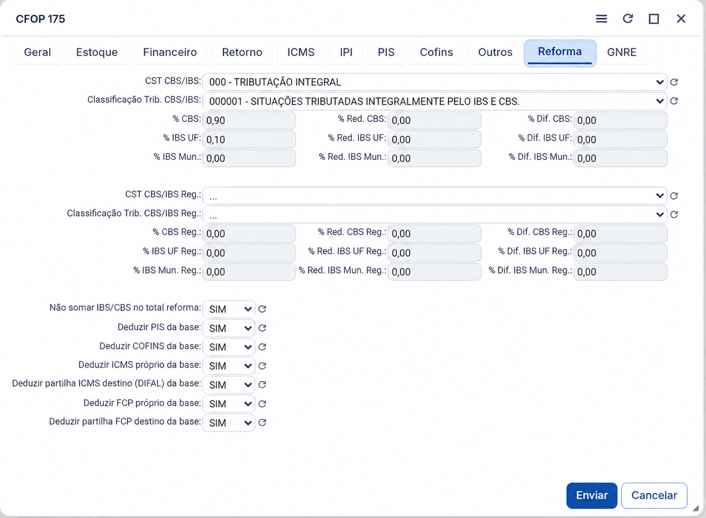
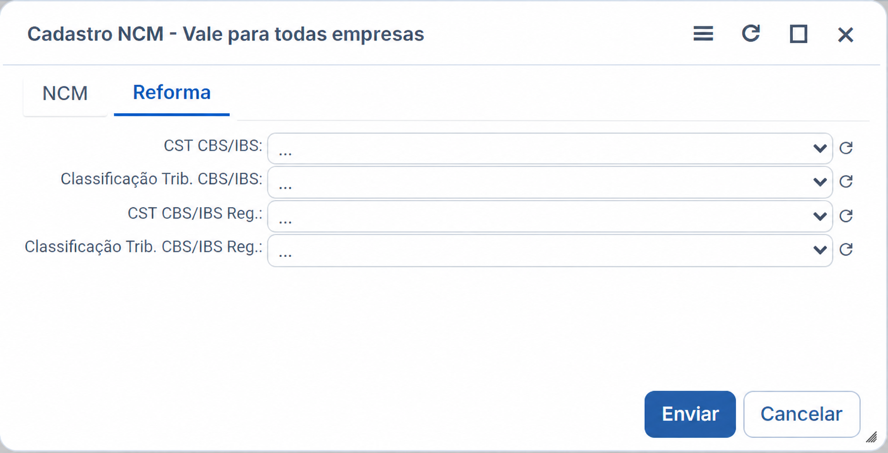

# Task 4 — Configurações fiscais globais

## Entrega

- O card **Configurações fiscais** abre uma consulta somente leitura em modal, sem pedir empresa e sem ler ou alterar `Empresa_Atual`.
- A consulta apresenta CFOP ou NCM, Id, situação tributária CBS/IBS e classificação tributária CBS/IBS.
- A tabela não exibe débito/crédito, alíquotas, campos regulares nem a coluna de pendência.
- A listagem é paginada em 50 registros por vez e informa o total; o CSV contém todos os registros do filtro aplicado.
- Os estados apresentados ao usuário são **Configurado** e **Não configurado**; quando a estrutura necessária não existir, a API informa que a conferência não está disponível.
- A consulta informa que, na regra de alíquotas, o CFOP preenchido é preferencial: existindo configuração no CFOP, as informações do NCM não são utilizadas, mesmo se estiverem preenchidas.
- O botão **Ver onde alterar esta configuração** abre o guia dos caminhos de manutenção de CFOP e NCM.

## Evidência de descoberta

- CFOP é mantido em **Fiscal → CFOP → aba Reforma**. O grid da rotina consulta o cadastro de CFOP sem filtro pela empresa ativa.
- NCM global é mantido em **Fiscal → NCM → Cadastro NCM – Vale para todas empresas → aba Reforma**. A rotina distingue esse cadastro das regras de NCM por empresa.
- Os campos de situação tributária e classificação tributária CBS/IBS existem nos dois cadastros. As definições de débito/crédito CBS e IBS existem no cadastro de CFOP.
- A consulta do módulo usa somente esses cadastros, sem predicado por empresa nem acesso a `Empresa_Atual`.

## Guia visual — CFOP

1. Em **Fiscal → CFOP**, abra a aba **Reforma**.
2. Preencha **CST CBS/IBS** e **Classificação Trib. CBS/IBS**. Na regra de alíquotas, a configuração do CFOP é preferencial sobre a do NCM.

## Guia visual — NCM

1. Em **Fiscal → NCM**, acesse **Cadastro NCM – Vale para todas empresas** e abra a aba **Reforma**.
2. Preencha **CST CBS/IBS** e **Classificação Trib. CBS/IBS**.

## Regra de conferência

- CFOP e NCM: conta cadastros ativos. Sem cadastro ativo, há pendência de cadastro.
- Situação tributária e classificação: conta registros ativos sem a respectiva informação nos cadastros global de CFOP e NCM.
- Débito/crédito CBS e IBS não fazem parte da listagem nem do cálculo de situação exibido ao usuário.
- Se as estruturas necessárias não existirem na base consultada, a tela não estima pendências: informa que a conferência ainda não está disponível.

## Testes locais

- Aprovados: `php -l aplicacoes/fiscal/reformaTributaria/src/FiscalConfiguration.php`
- Aprovados: `php -l aplicacoes/fiscal/reformaTributaria/public/configuracoes-fiscais-view.php`
- Aprovados: `php -l aplicacoes/fiscal/reformaTributaria/public/configuracoes-fiscais.php`
- Aprovados: `php -l aplicacoes/fiscal/reformaTributaria/public/index.php`
- Aprovado: `git diff --check`
- Conferido: a fonte devolve `D006_Id AS id` para CFOP e `D005_Id AS id` para NCM; o código do cadastro não é usado como Id.
- Conferido: os novos arquivos da consulta não referenciam empresa atual, seleção de empresa ou cadastro de empresa.
- Conferido estaticamente: CFOP/NCM, filtros de situação, busca e exportação CSV (UTF-8 com BOM e `;`) são ligados ao resultado filtrado.

## Pendência de validação no Hardness

A base local de teste disponível nesta tarefa não possui os cadastros fiscais necessários. A consulta foi protegida para exibir indisponibilidade de conferência nesse caso. Validar no navegador, em uma base Hardness com CFOP/NCM e os campos da Reforma Tributária aplicados, a presença dos Ids, a troca entre CFOP/NCM, os filtros, a busca e o conteúdo do CSV.
